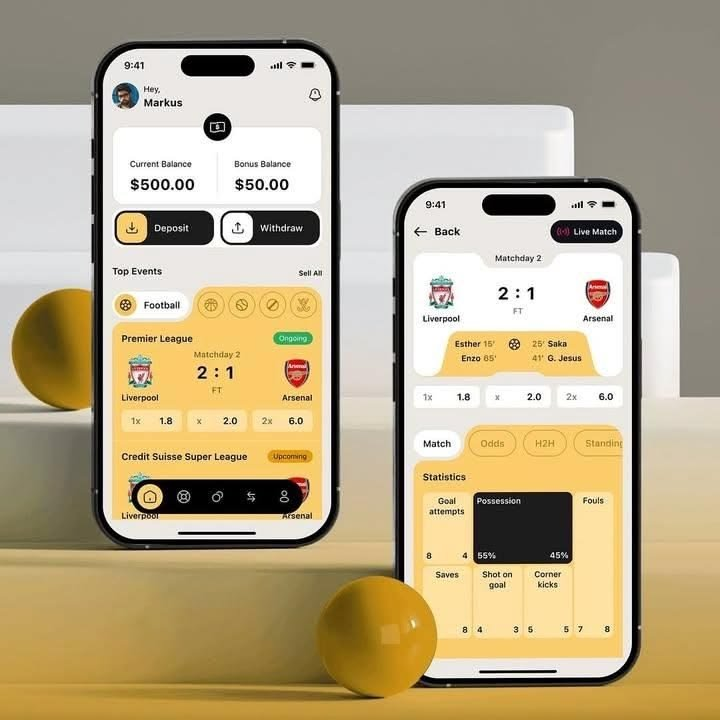
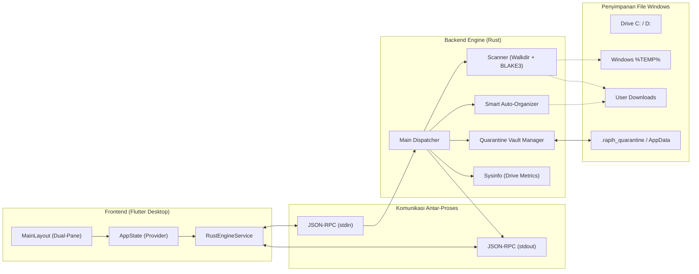

<p align="center">
  
</p>

<h1 align="center">🌿 Rapih Euy</h1>

<p align="center">
  <b>Aesthetic File Organizer, Smart Disk Cleaner & Quarantine Vault for Windows</b><br/>
  <i>Dibangun dengan kecepatan murni <b>Rust Backend</b> & keanggunan UI <b>Flutter Desktop</b> bergaya Matcha & Warm Oatmeal Pastel.</i>
</p>

<p align="center">
  
  
  
  
  
</p>

---

## 📌 Mengapa Rapih Euy Dibuat?

Sering kali ruang penyimpanan Windows tiba-tiba penuh—terutama di Drive `C:` yang tersisa beberapa megabyte saja—karena tumpukan puluhan ribu file `%TEMP%` sistem, installer bekas di folder Downloads, dan file duplikat berukuran besar yang terlupakan.

Aplikasi pembersih konvensional sering kali bekerja seperti *black-box*: menghapus file secara agresif tanpa izin rinci dan berisiko merusak data kerja kita.

**Rapih Euy lahir dengan filosofi berbeda:**
> 🔒 **"Selalu Tanya Aku"**: Tidak ada file yang dihapus tanpa persetujuan eksplisit pengguna. Dilengkapi **Brankas Karantina Aman** dengan fitur **1-Klik Restore**, sehingga file tidak langsung musnah dan dapat dikembalikan ke tempat asalnya kapan saja.

---

## ✨ Fitur Unggulan

### 1. 🛡️ Prinsip Keamanan & Brankas Karantina
* **Transparansi Penuh**: Setiap file kandidat pembersihan dilengkapi checkbox individu, ukuran file, tanggal modifikasi, serta alasan rasional mengapa file tersebut disarankan untuk dibersihkan.
* **Isolasi Brankas Karantina (`.rapih_quarantine`)**: File yang disetujui dipindahkan ke folder karantina terenkripsi metadata `quarantine_index.json`.
* **1-Klik Restore**: Salah memilih file? Cukup buka tab Karantina dan klik *Restore*, file akan kembali persis ke folder asalnya.
* **Pembersihan Permanen Bertahap**: File hanya dihapus permanen jika kamu secara sadar memilih opsi *Kosongkan Brankas*.

### 2. ⚡ Rekomendasi Pembersih Berkecepatan Rust
* **Temp & Cache Windows**: Memindai file `.tmp`, `.log`, `.bak` lama yang sudah tidak terkunci oleh sistem.
* **Deteksi Duplikat Kriptografis (BLAKE3)**: Pendeteksian duplikat 2-tahap (penyaringan ukuran byte sama dilanjutkan hashing BLAKE3 berkecepatan multi-gigabyte per detik).
* **File Besar Terlupakan**: Menemukan file arsip/ISO/video `> 100 MB` yang tidak pernah disentuh selama berbulan-bulan.
* **Installer Usang**: Mendeteksi bekas file instalasi (`.exe`, `.msi`, `.iso`, `.crdownload`) yang tertinggal di folder Downloads.
* **Folder Kosong**: Mendeteksi direktori tanpa isi yang membuat struktur drive berantakan.

### 3. 📂 Smart Auto-Organizer
* Merapikan folder yang berantakan (seperti Downloads atau folder proyek) hanya dalam satu klik.
* Secara otomatis mengelompokkan file ke subfolder kategori standar:
  * 📄 **`Documents/`**: `.pdf`, `.docx`, `.xlsx`, `.pptx`, `.txt`, `.csv`
  * 🖼️ **`Images/`**: `.png`, `.jpg`, `.jpeg`, `.webp`, `.svg`, `.ico`
  * 🎬 **`Videos/`**: `.mp4`, `.mkv`, `.avi`, `.mov`, `.webm`
  * 📦 **`Archives/`**: `.zip`, `.rar`, `.7z`, `.tar`, `.gz`
  * ⚙️ **`Setups/`**: `.exe`, `.msi`, `.iso`, `.apk`
  * 💻 **`DevProjects/`**: `.rs`, `.dart`, `.py`, `.js`, `.ts`, `.json`, `.sql`
* **Anti-Collision**: Jika nama file target sudah ada, sistem otomatis menyematkan indeks numerik (`nama_1.ext`) sehingga tidak ada data yang tertimpa (*zero overwrite risk*).

### 4. 🎨 Estetika Desain Matcha & Warm Oatmeal Pastel
Mengadopsi bahasa visual modern minimalis yang terinspirasi dari layout kartu rounded mobile (seperti pada referensi gambar):

| Elemen Desain | Kode Hex | Visualisasi & Kegunaan |
| :--- | :---: | :--- |
| **Warm Oatmeal** | `#F8F6EE` | Latar belakang kanvas yang hangat dan teduh di mata |
| **Soft Matcha** | `#D5E5D5` | Aksen badge status, kategori, dan tombol aktif |
| **Deep Forest Matcha** | `#2E5339` | Tipografi tegas untuk judul badge dan kapasitas pulih |
| **Charcoal Slate** | `#22252A` | Kartu penyimpanan utama, pill navigasi, dan tombol aksi tegas |
| **Soft Butter Accent** | `#FDE8A1` | Aksen kartu duplikat identik |
| **Card Radii** | `24px - 28px` | Sudut membulat modern berkesan ramah dan organik |

---

## 🏗️ Arsitektur Sistem

Aplikasi ini menggunakan pendekatan **Decoupled Engine & Stdio JSON-RPC Daemon** yang sangat modular dan andal:



---

## 📁 Struktur Repositori

```text
rapih-euy/
├── assets/
│   └── design_inspiration.jpg   # Referensi visual tema Matcha & Oatmeal
├── docs/
│   └── ARCHITECTURE.md          # Dokumen teknis spesifikasi arsitektur
├── rapih_engine/                # BACKEND RUST
│   ├── Cargo.toml               # Dependensi Rust (sysinfo, blake3, walkdir, serde)
│   └── src/
│       ├── main.rs              # JSON-RPC daemon & CLI dispatcher
│       ├── models.rs            # Struct data file, disk info, & responses
│       ├── scanner.rs           # Walkdir scanner & fast blake3 hasher
│       ├── organizer.rs         # Aturan klasifikasi file & penanganan tabrakan
│       └── quarantine.rs        # Sistem brankas isolasi & 1-klik pemulihan
├── rapih_ui/                    # FRONTEND FLUTTER
│   ├── pubspec.yaml             # Flutter pubspec (Provider, Google Fonts, Intl)
│   └── lib/
│       ├── main.dart            # Titik masuk aplikasi
│       ├── theme/               # Definisi palet warna Matcha & Oatmeal
│       ├── models/              # Engine model parser
│       ├── services/            # Subprocess IPC service ke Rust
│       ├── providers/           # AppState (pengelolaan seleksi file & aksi)
│       ├── views/               # Tampilan Rekomendasi, Organizer, & Karantina
│       └── widgets/             # Komponen kartu ringkasan disk & file card
├── run_engine_test.ps1          # Skrip pengujian otomatis backend di sandbox
└── README.md                    # Dokumentasi utama proyek
```

---

## 🚀 Memulai & Menjalankan

### Cara Tercepat (Satu Perintah dari Root Proyek)
Cukup jalankan dari root folder `rapih-euy`:
```powershell
npm run dev
```
Perintah ini otomatis:
1. Mengompilasi backend Rust (`rapih_engine.exe`) dalam mode `--release`.
2. Menjalankan Rust engine server (`http://127.0.0.1:8787`) untuk akses langsung ke filesystem Windows.
3. Mendeteksi kesiapan toolchain: menjalankan **`flutter run -d windows`** jika Visual Studio C++ tersedia, atau otomatis membuka UI Flutter melalui **Chrome Live Bridge** yang terhubung langsung ke backend Rust!

### Prasyarat
1. **Windows 10 / 11**
2. **Node.js** (untuk menjalankan `npm run dev`)
3. **Rust Toolchain** (`cargo` & `rustc`)
4. **Flutter SDK** (`>= 3.2.0`)
5. *(Opsional untuk native `.exe` Windows)* Visual Studio 2022 **Desktop development with C++**

### Perintah Tambahan
```powershell
# Uji coba backend Rust di folder sandbox
npm run test:engine

# Kompilasi backend Rust secara terpisah
npm run build:engine

# Paksa jalankan mode native Windows Desktop (butuh VS C++)
npm run dev:windows

# Analisis kode Flutter
npm run analyze
```

---

## 🤝 Berkontribusi
Kontribusi selalu terbuka! Jika kamu memiliki ide deteksi file sampah baru (misalnya cache build tools seperti `node_modules`, target Rust, atau gradle cache), silakan buka *Issue* atau kirimkan *Pull Request*.

## 📄 Lisensi
Proyek ini dilisensikan di bawah lisensi **MIT License**. Bebas dimodifikasi, dipelajari, dan didistribusikan.

<p align="center">
  Dibuat dengan ❤️ untuk menjaga ruang disk tetap lega dan rapih!
</p>
